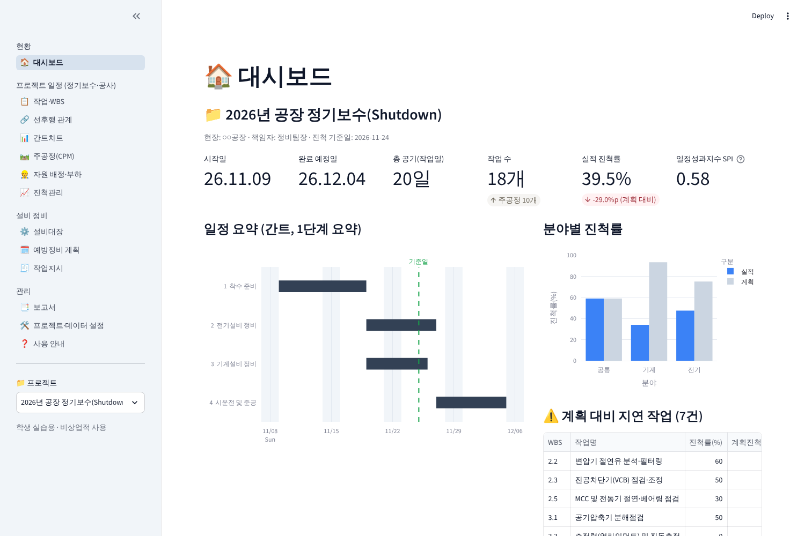
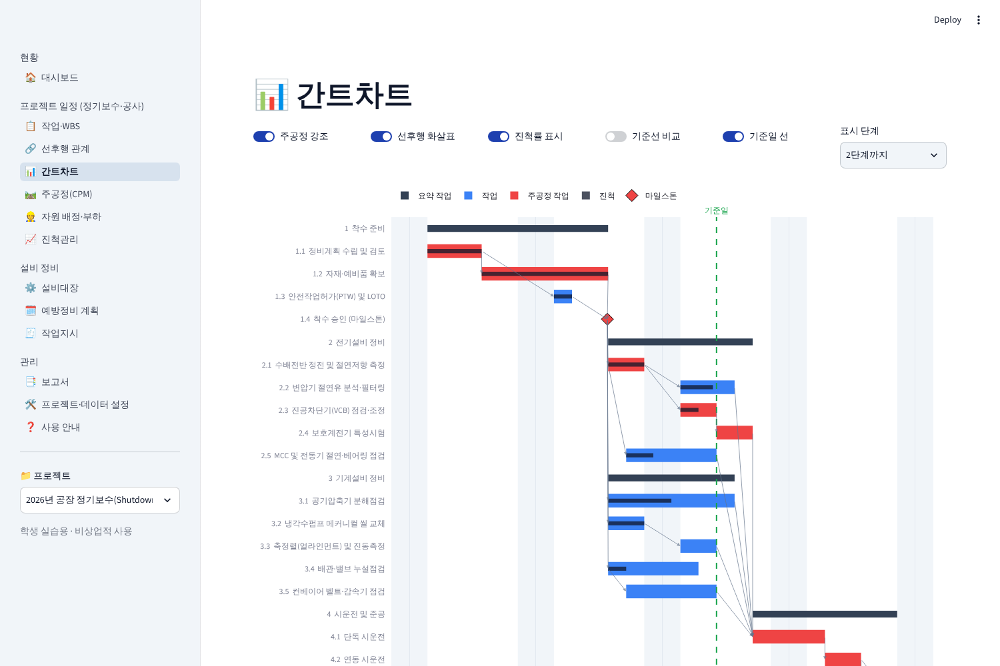
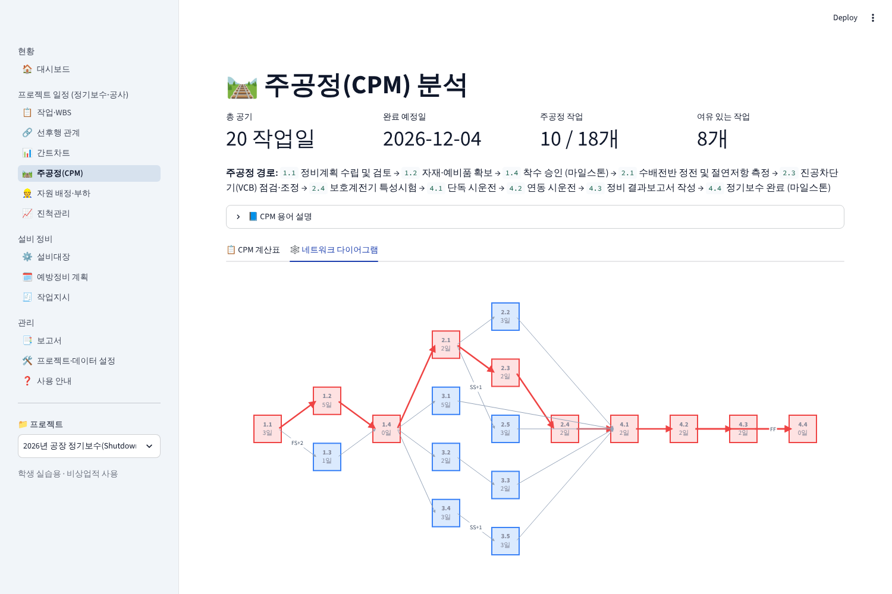
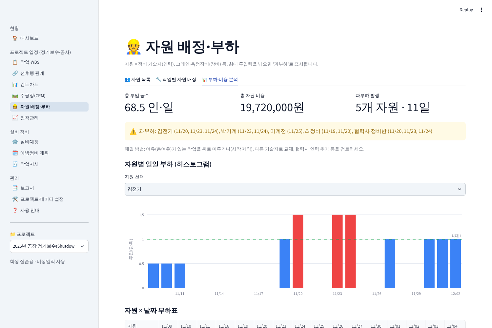

# 🛠️ 설비정비 일정관리 (maint-planner)

전기·기계 설비 정비 회사의 업무에 필요한 기능만 골라 만든 **파이썬 기반 웹 일정·정비 관리 프로그램**입니다.
오픈소스 프로젝트 관리 도구(ProjectLibre 등)의 핵심 개념(WBS, 간트차트, 선후행 관계, 주공정법, 자원, 진척/기준선, 보고서)을
참고하여 **Streamlit**으로 처음부터 새로 작성했으며, 여기에 설비 정비 실무 기능(설비대장, 예방정비 계획, 작업지시)을 더했습니다.

> 📚 **학생 실습용(비상업적)** 교육 자료입니다. ProjectLibre의 소스코드는 사용하지 않았습니다.



## 주요 기능

| 구분 | 기능 |
|---|---|
| **작업·WBS** | WBS 번호(1, 1.1, 1.2…)로 계층 구성, 요약 작업 자동 롤업, 마일스톤(기간 0), 시작 제약, 정비 작업 템플릿 |
| **선후행 관계** | FS·SS·FF·SF 4가지 관계, 지연(Lag)/앞당김(Lead), 순환 관계 자동 검출 |
| **간트차트** | 주공정 강조, 선후행 화살표, 진척 막대, 기준선 비교, 진척 기준일 선, 주말 음영, WBS 단계 접기 |
| **주공정(CPM)** | 전진/후진 계산(ES·EF·LS·LF), 총여유·자유여유, 네트워크 다이어그램, What-if 공기 분석 |
| **자원 배정·부하** | 기술자(인력)·크레인/측정장비(장비) 관리, 작업별 배정, 일별 부하 히스토그램, 과부하 탐지, 비용 집계 |
| **진척관리** | 기준선(Baseline) 저장, 진척률·실제 시작/완료일 입력(일정 재계산), 계획 대비 실적, 획득가치(PV·EV·SPI) |
| **설비대장** | 설비코드·분야·중요도(A/B/C)·위치·상태, 설비별 정비 이력 |
| **예방정비 계획** | 주기 기반 점검 항목, 도래/기한초과 현황, 90일 달력, **작업지시 자동 발행** |
| **작업지시(WO)** | 요청→승인→진행중→완료 흐름, 유형(PM/PdM/BM/CM/점검)·우선순위, 공수 기록, 완료 시 PM 실시일 자동 갱신 |
| **보고서** | 종합보고서·일정표·주공정·지연작업·자원배정·작업지시·예방정비 → **엑셀 / 인쇄용 HTML(PDF 저장) / CSV** |
| **데이터 관리** | 다중 프로젝트, 작업구조 복사, 휴일·주말 달력, JSON 백업/복원, 예제 데이터 초기화 |

처음 실행하면 **"공장 정기보수(Shutdown)" 예제 프로젝트**(변압기·차단기·전동기·공기압축기·펌프·컨베이어 정비, 기술자/장비 10종,
예방정비 8건, 작업지시 6건)가 자동으로 만들어져 바로 실습할 수 있습니다.

| 간트차트 | 네트워크 다이어그램 | 자원 부하 |
|---|---|---|
|  |  |  |

## 1. 내 PC에서 실행하기

**준비물:** Python 3.10 이상

```bash
# 1) 내려받기
git clone https://github.com/iksangyoo-sys/maint-planner.git
cd maint-planner

# 2) (권장) 가상환경 만들기
python -m venv .venv
# Windows:   .venv\Scripts\activate
# macOS/Linux: source .venv/bin/activate

# 3) 패키지 설치
pip install -r requirements.txt

# 4) 실행 → 브라우저에서 http://localhost:8501 자동 열림
streamlit run app.py
```

Git이 없다면 GitHub 페이지의 **Code → Download ZIP**으로 받아 압축을 푼 폴더에서 3)~4)를 실행하면 됩니다.

## 2. 웹에 배포하기 (무료, Streamlit Community Cloud)

학생들이 설치 없이 웹 주소로 접속하게 하려면:

1. <https://share.streamlit.io> 에 GitHub 계정으로 로그인
2. **Create app → Deploy a public app from GitHub** 선택
3. Repository: `iksangyoo-sys/maint-planner`, Branch: `main`, Main file path: `app.py`
4. (선택) App URL 을 원하는 이름으로 지정 → **Deploy**
5. 1~2분 뒤 `https://<이름>.streamlit.app` 주소가 생기면 학생들에게 공유

> ⚠️ **데이터 보관 주의:** 무료 클라우드는 앱이 일정 시간 사용되지 않거나 재배포되면 서버의 DB 파일이 초기화됩니다.
> 또한 하나의 앱 주소를 여러 학생이 함께 쓰면 **같은 데이터를 공유**합니다.
> - 실습 결과는 **프로젝트·데이터 설정 → 백업**으로 JSON 파일을 내려받아 보관하고, 필요할 때 **복원**하세요.
> - 학생별 독립 실습이 필요하면 각자 PC에서 실행하거나, 각자 이 저장소를 Fork 하여 자기 앱으로 배포하게 하세요.

### 다른 배포 방법
- **사내 서버/PC 공유:** `streamlit run app.py --server.address 0.0.0.0 --server.port 8501` 실행 후 같은 네트워크에서 `http://서버IP:8501` 접속
- **Docker:**
  ```bash
  docker run -it --rm -p 8501:8501 -v "$PWD":/app -w /app python:3.12-slim \
    sh -c "pip install -r requirements.txt && streamlit run app.py --server.address 0.0.0.0"
  ```
- DB 파일 위치는 환경변수 `MAINT_DB` 로 바꿀 수 있습니다. (기본값 `data/maint.db`)

## 3. 사용 순서 (요약)

1. **프로젝트·데이터 설정** – 프로젝트 생성, 시작일·휴일·주말근무 여부 설정
2. **작업·WBS** – 작업과 기간 입력 (템플릿으로 빠르게 추가 가능)
3. **선후행 관계** – 작업 순서 연결 (FS/SS/FF/SF + Lag)
4. **간트차트 / 주공정(CPM)** – 일정·주공정 확인, What-if 분석
5. **자원 배정·부하** – 기술자·장비 배정, 과부하 해소
6. **진척관리** – 기준선 저장 → 진척 입력 → 계획 대비 실적·SPI 확인
7. **설비대장 / 예방정비 계획 / 작업지시** – 일상 정비 업무 관리
8. **보고서** – 엑셀·HTML로 내려받기

앱 안의 **❓ 사용 안내** 화면에 학생용 실습 과제 6가지가 들어 있습니다.

## 4. 폴더 구조

```
maint-planner/
├── app.py                 # 진입점 (메뉴 구성)
├── core/                  # 화면과 무관한 계산·데이터 로직
│   ├── scheduler.py       # 작업일 달력 + CPM(전진/후진 계산, 여유, 요약 롤업)
│   ├── service.py         # 일정·자원부하·획득가치·예방정비/작업지시 로직
│   ├── charts.py          # 간트차트, 네트워크 다이어그램, 자원 히스토그램 (Plotly)
│   ├── reports.py         # HTML·엑셀 보고서
│   ├── db.py              # SQLite 스키마, CRUD, 백업/복원
│   └── sample_data.py     # 정기보수 예제 데이터
├── views/                 # 각 화면 (Streamlit 페이지)
├── tests/                 # pytest 테스트 (CPM 계산, 서비스, 전체 화면 렌더링)
└── requirements.txt
```

## 5. 일정 계산 규칙 (CPM)

- 시간 단위는 **작업일**입니다. 주말(선택)과 지정 휴일은 건너뜁니다.
- 작업 i 는 [ES, EF) 구간을 차지하고 EF = ES + 기간 입니다.
- 관계 제약: FS `후행 ES ≥ 선행 EF + lag`, SS `후행 ES ≥ 선행 ES + lag`, FF `후행 EF ≥ 선행 EF + lag`, SF `후행 EF ≥ 선행 ES + lag`
- 총여유 = LS − ES, 총여유 ≤ 0 이면 주공정 작업
- 실제 시작일이 입력된 작업은 그 날짜로 고정되고, 실제 완료일이 있으면 기간이 실적으로 바뀌어 후속 작업이 재계산됩니다.
- 하위 작업이 있는 작업(요약 작업)은 하위 작업의 최소 시작~최대 완료로 계산되며, 관계 연결 대상에서 제외됩니다.

## 6. 테스트

```bash
pip install pytest
python -m pytest -q
```

## 라이선스

MIT License – 교육·실습 목적의 자유로운 사용과 수정을 허용합니다. 자세한 내용은 [LICENSE](LICENSE)를 참고하세요.
ProjectLibre는 해당 저작권자의 상표이며, 이 프로그램은 ProjectLibre와 관련이 없는 독립적인 교육용 구현입니다.
