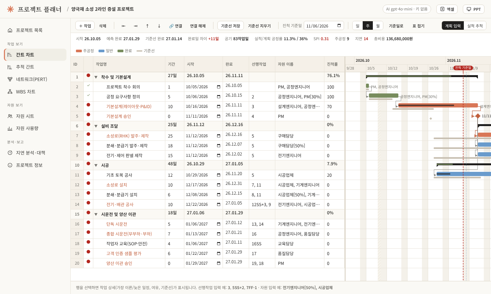

# 프로젝트 플래너 (Flask)

오픈소스 일정관리 도구 **ProjectLibre**의 화면 구성과 기능(작업표+간트, 추적 간트, 네트워크/PERT, WBS 차트, 자원 시트·사용량, 기준선)을
참고해 **Flask**로 새로 만든 웹 일정관리 프로그램입니다. ProjectLibre의 소스코드나 설치 파일은 사용하지 않았습니다.
여기에 **엑셀·파워포인트 저장**과 **gpt-4o-mini 기반 일정 지연 대책 보고서(Word .docx)** 기능을 더했습니다.
디자인은 따뜻한 아이보리 바탕 · 테라코타 포인트 · 세리프 제목의 Claude 계열 톤을 따랐습니다.



## 기능

| ProjectLibre 보기 | 이 앱 | 내용 |
|---|---|---|
| Gantt | 간트 차트 | 작업표(ID·작업명·기간·시작·완료·선행작업·자원·진척률) + 간트, 들여쓰기/내어쓰기 WBS, 요약 작업 접기, 일/주/월 눈금, 선후행 화살표, 주공정 강조 |
| Tracking Gantt | 추적 간트 | 실제 시작/완료·진척률 입력, 기준선 막대(회색) 대비 예측 일정, 완료 차이(일) |
| Network | 네트워크(PERT) | 작업 노드(시작·완료·기간·여유)를 단계별 배치, 주공정 경로 |
| WBS | WBS 차트 | 계층도 + 진척 막대 |
| Resources / Resource Usage | 자원 시트·자원 사용량 | 최대 단위·단가, 작업별 배정(예: `전기엔지니어[50%]`), 주별/일별 부하, 과부하 표시, 비용 |
| Project Information | 프로젝트 정보 | 시작일, 진척 기준일(Status date), 주말·휴일 달력 |
| (추가) | 지연 분석·대책 | 기준선 대비 지연·주의 작업, SPI, **gpt-4o-mini 지연 대책 보고서 → .docx** |
| (추가) | 저장 | **엑셀(.xlsx)**: 작업목록·간트·자원·지연분석 시트 / **PPT(.pptx)**: 요약·간트·지연·주공정·자원 슬라이드 / JSON 백업·복원 |

**일정 계산**: 작업일 달력(주말·휴일 제외), 선후행 FS·SS·FF·SF + 지연/리드(예: `3`, `5SS+2`, `7FF-1`), 요약 작업 롤업,
CPM 전진·후진 계산(ES·EF·LS·LF, 총여유·자유여유), 순환 관계 검출, 시작 제한일.
**진척 기준일**을 정하면 진행 중 작업의 잔여 기간을 기준일 이후로 다시 배치하고 미착수 작업은 기준일 이전에 시작하지 못하게 해서
"이대로 가면 언제 끝나는가"(예측 일정)를 구하고, 이를 기준선과 비교해 지연을 판정합니다.

## 실행

```bash
cd flask_planner
python -m venv .venv && source .venv/bin/activate   # Windows: .venv\Scripts\activate
pip install -r requirements.txt
python app.py            # http://127.0.0.1:5000
```

첫 화면에서 **예제 프로젝트 불러오기**를 누르면 「양극재 소성 2라인 증설 프로젝트」(가상 데이터, 기준선 저장 후 진척 기준일 2026-11-06 현재 11작업일 지연 상태)가 만들어집니다.

### OpenAI 키
보고서는 환경변수 `OPENAI_API_KEY`를 읽어 `gpt-4o-mini`(변경 시 `OPENAI_MODEL`)를 호출합니다. 키가 없거나 호출이 실패하면
일정 데이터만으로 만든 **규칙 기반 초안**으로 대신 작성하고 화면에 안내합니다. `.env.example`을 `.env`로 복사해 써도 됩니다(운영체제 환경변수가 우선).

보고서 구성: 핵심 메시지 → 핵심 요약 → 일정 현황(기준선/예측 완료일, 공정률, SPI) → 지연 작업 상세 → 원인 분석 → 만회 대책(공정 압축·공정 중첩·자원 재배치 등, 담당·기한·만회일수) → 만회 일정 → 리스크 → 의사결정 요청 → 결론 → 주공정 목록.

## 구조

```
flask_planner/
├─ app.py                 라우트(화면·API·내보내기)
├─ planner/
│  ├─ scheduler.py        작업일 달력, WBS, CPM, 진척 기준일 예측, 기준선 비교, 네트워크 배치
│  ├─ service.py          SQLite 읽기/쓰기, 작업표 저장, 자원 사용량, JSON 백업
│  ├─ exports.py          엑셀·PPT 생성
│  ├─ report.py           gpt-4o-mini 호출, 규칙 기반 초안, Word(.docx) 생성
│  ├─ sample.py           예제 프로젝트
│  └─ db.py
├─ templates/ static/     화면(간트는 static/js/gantt.js, 외부 라이브러리 없음)
└─ tests/                 pytest
```

테스트: `pip install pytest && python -m pytest -q tests`

## 키보드
작업표에서 Enter 아래 행, Alt+→ 들여쓰기, Alt+← 내어쓰기, (셀 밖에서) Insert 작업 추가, Delete 삭제, ↑↓ 행 선택.
